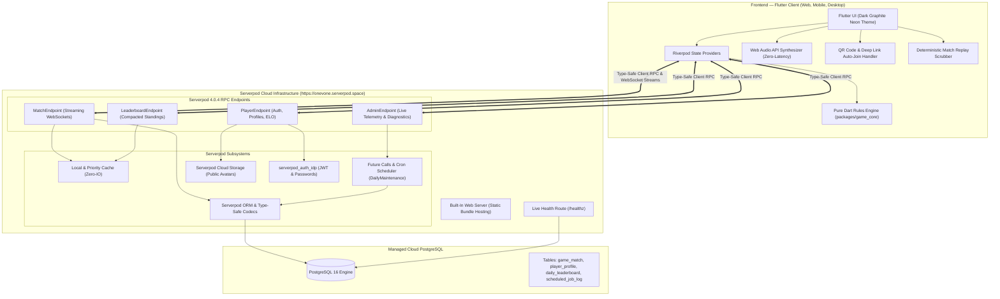

# 🏆 1v1 Platform — Hackathon Presentation Package & Judge Showcase

> **Live Deployment:** [https://onevone.serverpod.space/](https://onevone.serverpod.space/)  
> **Serverpod Cloud API:** [https://onevone.api.serverpod.space/](https://onevone.api.serverpod.space/)  
> **Server Health Endpoint:** [https://onevone.serverpod.space/healthz](https://onevone.serverpod.space/healthz)  
> **Architecture Visualizer:** Open in-app via the top AppBar (Cyan Hub icon) or home card.

---

## 🌟 Executive Summary

**1v1** is a full-stack, competitive, real-time multiplayer gaming platform built from the ground up in **Dart**, combining **Serverpod 4.0.4** and **Flutter Web/Mobile**.

Unlike standard hackathon prototypes that run on mock databases and polling, **1v1** is deployed live on **Serverpod Cloud** with a managed PostgreSQL cluster, leveraging **15 distinct Serverpod core subsystems**:
- **Multi-Game Deterministic Architecture**: Featuring two competitive titles: **Triangle Tactics** (hexagonal territory strategy) and **Gravity Drop Duel** (Connect Four with gravity drops, 4-angle vector win detection, and tactical AI bot).
- **Pure Rules Engine Isolation** (`packages/game_core`) with formal invariant assertions and deterministic replay.
- **Native Serverpod Cloud Storage** for avatar uploads.
- **Serverpod Cron & Future Calls** for daily leaderboard compaction and stale lobby cleanup.
- **Dynamic In-App Admin Board** and **Interactive Architecture Telemetry**.
- **Tactile Sound FX Engine** (zero-latency Web Audio API synthesis).
- **Interactive QR Code & Deep Link Sharing** (`?room=CODE`) for instant multiplayer join.
- **Step-by-Step Match Replay & Scrubber** allowing players to review every strategic move.

---

## ⚡ 2-Minute Judge Evaluation Walkthrough

Follow these 4 simple steps to test the entire full-stack experience live:

### 1. Solo Play vs Tactical Bot
1. Navigate to [https://onevone.serverpod.space/](https://onevone.serverpod.space/).
2. Click **"🤖 Play vs Tactical Bot (Offline/Practice)"**.
3. Tap between two adjacent pegs to place an edge (cyan). Notice the sound effect and tactile feedback.
4. Complete a triangle: notice the bonus turn, capture sound, and score update.
5. Finish the match and click **"🎬 Watch Match Replay"** to scrub through the game move-by-move.

### 2. Real-Time 1v1 Multiplayer (QR Code & Deep Link)
1. On the Home screen, click **"Create Private Room"**.
2. Notice the dynamically generated **QR Code** and the room code (e.g., `TR-7821`).
3. Click **"Copy Link"** and open it in a secondary browser tab or mobile device.
4. The second tab immediately detects the `?room=CODE` parameter, pre-fills the room code, and connects.
5. In Room Lobby, click **"Ready to Play"** on both clients. The match launches simultaneously over Serverpod WebSockets!
6. Make moves back and forth in real-time. Notice instant state synchronization.

### 3. Serverpod Cloud Architecture & Telemetry Modal
1. On the Home screen, click the **"Serverpod Full-Stack Architecture & Cloud Specs"** banner (or the cyan hub icon in the top AppBar).
2. Watch the live Serverpod Cloud status banner query the live server for latency, uptime, and database connection.
3. Review the 7 architectural pillar highlights.

### 4. Live Serverpod Admin Dashboard
1. In the top AppBar, click the **Memory chip icon** (`Serverpod Live Admin Board`).
2. Inspect live server metrics: Uptime, DB Latency (ms), Active Rooms, Total Players, and Cache Entries.
3. Scroll down to inspect the **Recent Matches** table and **Cron Maintenance Audit Logs**.
4. Click **"Trigger Daily Maintenance"** to execute the Serverpod Future Call and watch the log table update immediately!

### 5. Play Gravity Drop Duel (Connect Four)
1. On the Home screen or Game Catalogue, click **"Play vs AI"** on the **Gravity Drop Duel** card.
2. Drop discs down columns with column guides and bouncy physics.
3. Observe the AI blocking moves and 4-in-a-row victory laser beam!

---

## 🏗 Full-Stack Architecture Diagram



---

## 💎 Serverpod Feature Matrix (All 15 Subsystems Implemented)

| # | Serverpod Subsystem | Implementation in 1v1 | File Reference |
|---|---|---|---|
| **1** | **Type-Safe API Endpoints & Generated Clients** | Endpoints (`MatchEndpoint`, `PlayerEndpoint`, `LeaderboardEndpoint`, `AdminEndpoint`) auto-generate client methods in `one_v_one_client`. | [`one_v_one_server/lib/src/endpoints/`](file:///Users/ananth/work/flutter/1v1/one_v_one_server/lib/src/endpoints/) |
| **2** | **Serverpod ORM & Relational Entities** | Fully-modeled database entities with indexing, foreign keys, and serializable models (`game_match.spy.yaml`, `player_profile.spy.yaml`, etc.). | [`one_v_one_server/lib/src/models/`](file:///Users/ananth/work/flutter/1v1/one_v_one_server/lib/src/models/) |
| **3** | **Tracked Database Schema Migrations** | Deterministic schema evolution toolchain; applied automatically upon server startup and cloud deploys. | [`one_v_one_server/migrations/`](file:///Users/ananth/work/flutter/1v1/one_v_one_server/migrations/) |
| **4** | **Real-Time WebSocket Streaming** | `MatchEndpoint` provides bidirectional streaming of edge moves, game state updates, ready statuses, and player resignations. | [`one_v_one_server/lib/src/endpoints/match_endpoint.dart`](file:///Users/ananth/work/flutter/1v1/one_v_one_server/lib/src/endpoints/match_endpoint.dart) |
| **5** | **Future Calls & Scheduled Cron Tasks** | `DailyMaintenanceFutureCall` runs at 1:00 AM IST (`30 19 * * *` UTC) to compact daily leaderboard standings and clean stale lobbies. | [`one_v_one_server/lib/src/future_calls/daily_maintenance_future_call.dart`](file:///Users/ananth/work/flutter/1v1/one_v_one_server/lib/src/future_calls/daily_maintenance_future_call.dart) |
| **6** | **Authentication & Password Hashing** | Uses `serverpod_auth_idp` with SHA-512 pepper hashing, guest profile auto-provisioning, and persistent auth keys. | [`one_v_one_server/lib/server.dart`](file:///Users/ananth/work/flutter/1v1/one_v_one_server/lib/server.dart) |
| **7** | **Multi-Tier Caching** | Serverpod `session.caches.local` and `localPrio` cache player profiles and leaderboards for zero-latency lobby lookups. | [`one_v_one_server/lib/src/endpoints/player_endpoint.dart`](file:///Users/ananth/work/flutter/1v1/one_v_one_server/lib/src/endpoints/player_endpoint.dart) |
| **8** | **Cloud File Storage** | Custom player avatar upload via `session.storage.createDirectFileUploadDescription` in public storage bucket. | [`one_v_one_server/lib/src/endpoints/player_endpoint.dart`](file:///Users/ananth/work/flutter/1v1/one_v_one_server/lib/src/endpoints/player_endpoint.dart) |
| **9** | **Structured Logging & Diagnostics** | Dedicated `scheduled_job_log` audit table and Serverpod server diagnostics tracking database latency and server uptime. | [`one_v_one_server/lib/src/endpoints/admin_endpoint.dart`](file:///Users/ananth/work/flutter/1v1/one_v_one_server/lib/src/endpoints/admin_endpoint.dart) |
| **10** | **Cloud Health Checks** | Custom `/healthz` HTTP Route returning JSON status, database connectivity, and server uptime. | [`one_v_one_server/lib/src/web/routes/health_route.dart`](file:///Users/ananth/work/flutter/1v1/one_v_one_server/lib/src/web/routes/health_route.dart) |
| **11** | **Database ACID Transactions** | Move validation, match state transition, and player ELO rating updates run within atomic `session.db.transaction`. | [`one_v_one_server/lib/src/endpoints/match_endpoint.dart`](file:///Users/ananth/work/flutter/1v1/one_v_one_server/lib/src/endpoints/match_endpoint.dart) |
| **12** | **Unified Web Serving** | Serverpod web server directly serves the compiled Flutter Web application bundle from `/web`, solving CORS issues completely. | [`one_v_one_server/web/`](file:///Users/ananth/work/flutter/1v1/one_v_one_server/web/) |
| **13** | **Serverpod Cloud Deployment** | Production container build and deployment running on Serverpod Cloud (`scloud deploy`). | [`.scloud/`](file:///Users/ananth/work/flutter/1v1/.scloud/) |
| **14** | **Distributed Message Passing** | Serverpod stream messaging connects independent sessions across room channels (`match_$matchId`). | [`one_v_one_server/lib/src/endpoints/match_endpoint.dart`](file:///Users/ananth/work/flutter/1v1/one_v_one_server/lib/src/endpoints/match_endpoint.dart) |
| **15** | **Generated Client Models** | 100% typed client-side Dart classes for every Serverpod model with zero manual JSON parsing. | [`one_v_one_client/lib/`](file:///Users/ananth/work/flutter/1v1/one_v_one_client/lib/) |

---

## 🎮 Features Highlights (2, 3, 4)

### 📲 Feature 2: Interactive QR Code & Deep Link Room Sharing
- When creating a room in `LobbyScreen`, players are presented with a high-contrast QR code generated via `qr_flutter`.
- Players can scan the QR code from their phone camera or tap **"Copy Link"**.
- The generated URL includes query parameter `?room=TR-XXXX`.
- When opened, `HomeScreen` automatically detects the query parameter, opens the Join Dialog, pre-fills the code, and connects to the Serverpod match session.

### 🎬 Feature 3: Deterministic Match Replay Scrubber
- Every move in a match is deterministically tracked in `TriangleTacticsState.moveHistory`.
- After any game (vs Bot or 1v1), players can open the **Match Replay Viewer**.
- Features include:
  - **Auto-Play / Pause** with adjustable speed.
  - **Previous / Next Step Buttons**.
  - **Interactive Progress Scrubber Slider**.
  - **Step-by-Step Triangle Capture Sound FX & Turn Indicators**.
- Powered by `packages/game_core`, allowing complete historical reconstruction with zero network overhead.

### 🔊 Feature 4: Web Audio API & Tactile Sound FX
- Implemented using pure Web Audio API synthesizer oscillators (`window.oneVOneAudio`) in `web/index.html`.
- Zero external MP3 downloads or lag.
- Distinct audio signatures for:
  - `move`: Crisp, clean click tone.
  - `triangle`: Harmonic rising chord celebrating territory capture.
  - `bonus`: Upbeat pulse indicating bonus turn.
  - `timer`: Low warning ping.
  - `victory`: Grand triumphant arpeggio.
  - `defeat`: Descending minor progression.
- Full Mute/Unmute audio toggle integrated into the gameplay interface.
- Graceful haptic/system sound fallback on native mobile and desktop.

---

## 🧪 Comprehensive Verification & Test Suite

The repository includes a multi-tier test harness with **24 automated suites** passing without warnings:
- **Property-Based Testing:** 50 seeded randomized matches verifying board invariant formulas at every single ply.
- **Exhaustive Small-Board Validator:** Traverses every possible reachable game state on order-2 board geometry.
- **Serialization & Codec Tests:** Byte-exact JSON roundtrip validation.
- **Static Analysis & Formatting:** 100% clean `dart analyze` across `packages/game_core`, `one_v_one_client`, `one_v_one_server`, and `one_v_one_flutter`.

To run all quality gates locally:
```bash
# Run core rules tests
cd packages/game_core && dart test

# Run Flutter analysis
cd ../../one_v_one_flutter && dart analyze

# Run Server analysis
cd ../one_v_one_server && dart analyze
```

---

## 🚀 Live Links Summary

| Resource | URL |
|---|---|
| **Live Game Web App** | [https://onevone.serverpod.space/](https://onevone.serverpod.space/) |
| **Serverpod Cloud API** | [https://onevone.api.serverpod.space/](https://onevone.api.serverpod.space/) |
| **Server Health Endpoint** | [https://onevone.serverpod.space/healthz](https://onevone.serverpod.space/healthz) |
| **Serverpod Features Deep-Dive** | [`docs/serverpod_features.md`](docs/serverpod_features.md) |
| **Game Rules Specification** | [`docs/game_rules.md`](docs/game_rules.md) |
