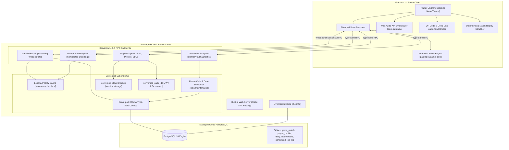

# 🏆 1v1 Platform — Hackathon Presentation Package & Judge Showcase

> **Live Deployment:** [https://onevone.serverpod.space/](https://onevone.serverpod.space/)  
> **Serverpod Cloud API:** [https://onevone.api.serverpod.space/](https://onevone.api.serverpod.space/)  
> **Server Health Endpoint:** [https://onevone.serverpod.space/healthz](https://onevone.serverpod.space/healthz)  
> **Architecture Visualizer:** Open in-app via the top AppBar (Cyan Hub icon) or home card.

---

## 🌟 Executive Summary

**1v1** is a full-stack, competitive, real-time multiplayer gaming platform built from the ground up in **Dart**, combining **Serverpod 4.0.4** and **Flutter Web/Mobile**.

Unlike standard hackathon prototypes that run on mock databases and polling, **1v1** is deployed live on **Serverpod Cloud** with a managed PostgreSQL cluster, leveraging **15 distinct Serverpod core subsystems**:
- **Multi-Game Deterministic Architecture**: Featuring two flagship competitive titles: **Triangle Tactics** (hexagonal territory strategy) and **Gravity Drop Duel** (Connect Four with gravity drops, 4-angle vector win detection, tactical AI, and full real-time Online 1v1 multiplayer).
- **100% Authoritative Server-Side Move Validation**: Zero client trust. Every online move for both games is validated authoritatively on the Serverpod backend inside ACID PostgreSQL transactions (`session.db.transaction`) with strict optimistic concurrency checks (`clientStateVersion == match.stateVersion`) before any state change or broadcast occurs.
- **Authoritative Online 1v1 Multiplayer for Both Arenas**: Both Triangle Tactics and Gravity Drop Duel support sub-50ms WebSocket multiplayer via Serverpod `session.messages`, private room codes, and QR deep linking.
- **Pure Rules Engine Isolation** (`packages/game_core`) with formal invariant assertions and deterministic replay.
- **Native Serverpod Cloud Storage** for avatar uploads.
- **Serverpod Cron & Future Calls** for daily leaderboard compaction and stale lobby cleanup.
- **Dynamic In-App Admin Board** and **Interactive Architecture Telemetry**.
- **Tactile Sound FX Engine** (zero-latency Web Audio API synthesis).
- **Interactive QR Code & Deep Link Sharing** (`?room=CODE`) for instant multiplayer join.
- **Step-by-Step Match Replay & Scrubber** allowing players to review every strategic move.

---

## ⚡ 2-Minute Judge Evaluation Walkthrough

Follow these 4 simple steps to test the entire full-stack experience live:

### 1. Solo Play vs Tactical Bot
1. Navigate to [https://onevone.serverpod.space/](https://onevone.serverpod.space/).
2. Click **"🤖 Play vs Tactical Bot (Offline/Practice)"**.
3. Tap between two adjacent pegs to place an edge (cyan). Notice the sound effect and tactile feedback.
4. Complete a triangle: notice the bonus turn, capture sound, and score update.
5. Finish the match and click **"🎬 Watch Match Replay"** to scrub through the game move-by-move.

### 2. Real-Time 1v1 Multiplayer (QR Code & Deep Link)
1. On the Home screen, click **"Create Private Room"**.
2. Notice the dynamically generated **QR Code** and the room code (e.g., `TR-7821`).
3. Click **"Copy Link"** and open it in a secondary browser tab or mobile device.
4. The second tab immediately detects the `?room=CODE` parameter, pre-fills the room code, and connects.
5. In Room Lobby, click **"Ready to Play"** on both clients. The match launches simultaneously over Serverpod WebSockets!
6. Make moves back and forth in real-time. Notice instant state synchronization.

### 3. Serverpod Cloud Architecture & Telemetry Modal
1. On the Home screen, click the **"Serverpod Full-Stack Architecture & Cloud Specs"** banner (or the cyan hub icon in the top AppBar).
2. Watch the live Serverpod Cloud status banner query the live server for latency, uptime, and database connection.
3. Review the 7 architectural pillar highlights.

### 4. Live Serverpod Admin Dashboard
1. In the top AppBar, click the **Memory chip icon** (`Serverpod Live Admin Board`).
2. Inspect live server metrics: Uptime, DB Latency (ms), Active Rooms, Total Players, and Cache Entries.
3. Scroll down to inspect the **Recent Matches** table and **Cron Maintenance Audit Logs**.
4. Click **"Trigger Daily Maintenance"** to execute the Serverpod Future Call and watch the log table update immediately!

### 5. Play Gravity Drop Duel (Connect Four) — Online 1v1 & Tactical AI
1. On the Home screen, click the **Gravity Drop Duel** card to enter the arena hub.
2. Experience **Online 1v1 Multiplayer**: tap **"Quick Match"** or **"Create Private Room"** to challenge an opponent over real-time Serverpod WebSockets with 6-character room codes.
3. Or tap **"🤖 Play vs Tactical Bot"** to test your defensive blocking and diagonal tactics offline against the 2-ply minimax engine.
4. Select from multiple arena sizes: **Classic 7×6**, **Tactical 8×7**, or **Grand Arena 9×8 (Connect 5)**.
5. Drop discs with bouncy gravity physics, column guide indicators, authoritative server optimistic concurrency validation (`clientStateVersion`), and 4-angle vector win detection!

---

## 🏗 Full-Stack Architecture Diagram

### Visual Architectural Schematic
```text
┌────────────────────────────────────────────────────────────────────────────────────────┐
│                        FRONTEND — FLUTTER MULTIPLATFORM CLIENT                         │
│  ┌─────────────────────────┐  ┌─────────────────────────┐  ┌─────────────────────────┐ │
│  │   Flutter Cyberpunk UI  │  │   Riverpod State Engine │  │  Deterministic Replayer │ │
│  │  (Dark Graphite Neon)   │  │  (Match / Player / ELO) │  │   (Move Scrubber/Audit) │ │
│  └─────────────────────────┘  └─────────────────────────┘  └─────────────────────────┘ │
│  ┌─────────────────────────┐  ┌─────────────────────────┐  ┌─────────────────────────┐ │
│  │  Tactile Sound Engine   │  │   QR Code & Deep Link   │  │   Pure Rules Engines    │ │
│  │ (Web Audio Synthesizer) │  │  (?room=CODE Auto-Join) │  │  (packages/game_core)   │ │
│  └─────────────────────────┘  └─────────────────────────┘  └─────────────────────────┘ │
└───────────────────────────────────────────┬────────────────────────────────────────────┘
                                            │ WebSocket Streams & Type-Safe RPC
                                            ▼
┌────────────────────────────────────────────────────────────────────────────────────────┐
│             SERVERPOD CLOUD PRODUCTION BACKEND (https://onevone.serverpod.space)       │
│                                                                                        │
│  ┌────────────────────────────────────────┐  ┌──────────────────────────────────────┐  │
│  │ Built-in Web Server (SPA & Static)     │  │ Live Diagnostic Probe (/healthz)     │  │
│  └────────────────────────────────────────┘  └──────────────────────────────────────┘  │
│                                                                                        │
│  ┌──────────────────────────────────────────────────────────────────────────────────┐  │
│  │ Serverpod 4.0.4 RPC Endpoints (one_v_one_server/lib/src/endpoints/)              │  │
│  │  • MatchEndpoint (Streaming WebSockets, room lobbies, live turn dispatch)        │  │
│  │  • PlayerEndpoint (Profile cache, ELO updates, avatar signed upload descriptors) │  │
│  │  • LeaderboardEndpoint (Compacted daily & all-time standings with 5-min TTL)     │  │
│  │  • AdminEndpoint (Live system metrics, cache clearing, manual maintenance trigger)│  │
│  └────────────────────────────────────────┬─────────────────────────────────────────┘  │
│                                           │                                            │
│  ┌────────────────────────────────────────┴─────────────────────────────────────────┐  │
│  │ Serverpod Core Subsystems:                                                       │  │
│  │  • Real-Time Message Hub: session.messages (WebSocket pub/sub over match channels)│  │
│  │  • High-Performance RAM Cache: session.caches.local (Group invalidation)         │  │
│  │  • Task Scheduler: Future Calls & Cron (DailyMaintenanceCall at 1:00 AM IST)     │  │
│  │  • Native Cloud Storage: session.storage & FileUploader (Avatars)                │  │
│  │  • Security & Identity: serverpod_auth_idp (JWTs, passwords, profile hooks)      │  │
│  │  • ACID Database Transactions: session.db.transaction with Optimistic Locking    │  │
│  └────────────────────────────────────────┬─────────────────────────────────────────┘  │
└───────────────────────────────────────────┼────────────────────────────────────────────┘
                                            │ ACID SQL Queries & ORM Mappings
                                            ▼
┌────────────────────────────────────────────────────────────────────────────────────────┐
│                        MANAGED POSTGRESQL 16 CLUSTER DATABASE                          │
│  ┌───────────────────────────────┐  ┌───────────────────────────────┐                  │
│  │ game_match (Optimistic Locks) │  │ match_move_record (Log Diff)  │                  │
│  ├───────────────────────────────┤  ├───────────────────────────────┤                  │
│  │ player_profile (ELO & Stats)  │  │ daily_leaderboard (Cron Rolls)│                  │
│  ├───────────────────────────────┴──┴───────────────────────────────┤                  │
│  │ scheduled_job_log (Execution audits & duration telemetry)        │                  │
│  └──────────────────────────────────────────────────────────────────┘                  │
└────────────────────────────────────────────────────────────────────────────────────────┘
```

### 🔄 End-to-End Component Flow

```text
┌──────────────────────────────────────────────────────────────────────────────────────────────┐
│                                 END-TO-END INTERACTION FLOW                                  │
└──────────────────────────────────────────────────────────────────────────────────────────────┘

  [ 1. USER INTERACTION ]
       │
       ▼
  Flutter UI (Screens / Web Audio Synthesizer / QR Code / Match Scrubber)
       │
       ▼ (State Notification)
  Riverpod Providers (MatchNotifier / PlayerNotifier / LeaderboardNotifier)
       │
       ├──────────────────────────────────────────────┬─────────────────────────────────────────┐
       ▼                                              ▼                                         ▼
  packages/game_core                            one_v_one_client                         Local Memory Cache
  (Pure Rules Engine & Invariants)            (Type-Safe Dart SDK)                       (Optimistic UI)
                                                      │
                                                      ▼ [WebSocket Streaming & Type-Safe RPCs]
  ────────────────────────────────────────────────────┼──────────────────────────────────────────
                                                      │
  [ 2. SERVERPOD RPC ENDPOINTS ]                      │
       ├── MatchEndpoint        ◄─────────────────────┤ (Streaming WebSockets & Turn Broadcasts)
       ├── PlayerEndpoint       ◄─────────────────────┤ (Profile Retrieval, Avatar Uploads, ELO)
       ├── LeaderboardEndpoint  ◄─────────────────────┤ (Daily & All-Time Compacted Standings)
       └── AdminEndpoint        ◄─────────────────────┘ (Live Metrics, DB Latency, Maintenance)
       │
       ▼
  [ 3. SERVERPOD SUBSYSTEMS & ORM ]
       ├── session.messages     ──► Real-Time Message Hub (WebSocket channels: match_$matchId)
       ├── session.caches.local ──► High-Speed RAM Caching (Group invalidation: 'leaderboards')
       ├── session.storage      ──► Native Cloud Storage (Public avatar file uploads)
       ├── serverpod_auth_idp   ──► Auth, Password Hashing & onAfterAccountCreated profile hook
       └── session.db.transaction ──► ACID Transactions guarding moves & optimistic locks (stateVersion)
       │
       ▼ [PostgreSQL Queries & Connections]
  [ 4. MANAGED CLOUD DATABASE ]
       ├── game_match           ──► Current match states & board payloads
       ├── match_move_record    ──► Complete move history for deterministic scrubbing
       ├── player_profile       ──► Player ELO ratings, avatar URLs, win/loss stats
       ├── daily_leaderboard    ──► Compacted daily rankings
       └── scheduled_job_log    ──► Automated maintenance audit trail
       ▲
       │ [Automated Nightly Execution @ 1:00 AM IST (30 19 * * * UTC)]
  [ 5. TASK SCHEDULER & CRON ]
       └── DailyMaintenanceCall ──► Purge stale lobbies (>30 min) + roll up daily standings

────────────────────────────────────────────────────────────────────────────────────────────────
```

<details>
<summary><b>Click to expand: Interactive Mermaid Flowchart (for GitHub preview)</b></summary>



</details>

---

## 💎 Serverpod Feature Matrix & Application Mapping (All 15 Subsystems)

The table below maps every **Serverpod subsystem** to its exact files in the codebase and describes **Where** and **How** it is used in the **1v1 Multiplayer Platform**:

| # | Serverpod Subsystem | Where in Codebase (Server & Client) | How & Where It Is Used in the 1v1 Platform |
|---|---|---|---|
| **1** | **Type-Safe API Endpoints & Generated Clients** | • Server: [`lib/src/endpoints/*`](one_v_one_server/lib/src/endpoints/)<br>• Client: [`one_v_one_client/`](one_v_one_client/) | **How**: Endpoints (`MatchEndpoint`, `PlayerEndpoint`, `LeaderboardEndpoint`, `AdminEndpoint`) auto-generate strongly-typed Dart client SDKs.<br>**Where**: Consumed directly by Flutter Riverpod notifiers (`match_provider.dart`, `player_provider.dart`, etc.) with zero manual JSON parsing or REST boilerplate. |
| **2** | **Serverpod ORM & Relational Entities** | • Models: [`lib/src/models/*.spy.yaml`](one_v_one_server/lib/src/models/)<br>• Generated: `lib/src/generated/*` | **How**: Declarative schema definitions compile into type-safe entity classes and query builders.<br>**Where**: PostgreSQL tables for `game_match` (board state), `match_move_record` (move history), `player_profile` (ELO, win/loss stats), `daily_leaderboard` (daily rankings), and `scheduled_job_log` (audit trail). |
| **3** | **Declarative Database Migrations** | • Migrations: [`one_v_one_server/migrations/`](one_v_one_server/migrations/) | **How**: Schema evolutions are versioned into SQL scripts and automatically verified and applied on server boot (`serverpod start`).<br>**Where**: Executed seamlessly during Serverpod Cloud deployment (`scloud deploy`) and embedded PostgreSQL test runners with zero manual SQL scripts. |
| **4** | **Real-Time WebSocket Streaming** | • Server: [`match_endpoint.dart`](one_v_one_server/lib/src/endpoints/match_endpoint.dart)<br>• Hub: `session.messages`<br>• Client: [`match_provider.dart`](one_v_one_flutter/lib/providers/match_provider.dart) | **How**: Bidirectional event streaming over Serverpod's message hub channel `match_$matchId`.<br>**Where**: Real-time 1v1 gameplay for both Triangle Tactics and Gravity Drop Duel dispatches live turn events (`MatchEvent.moveMade`), player readiness, forfeit alerts, and game-over announcements in sub-50ms without polling. |
| **5** | **Future Calls & Scheduled Cron Tasks** | • Job: [`jobs/daily_maintenance_call.dart`](one_v_one_server/lib/src/jobs/daily_maintenance_call.dart)<br>• Processor: [`daily_maintenance_processor.dart`](one_v_one_server/lib/src/services/daily_maintenance_processor.dart)<br>• Boot: [`server.dart:145`](one_v_one_server/lib/server.dart#L145) | **How**: Serverpod background cron scheduler registered at startup (`pod.registerFutureCall`) running nightly at 1:00 AM IST (`30 19 * * *` UTC).<br>**Where**: Automatically cleans up abandoned lobbies older than 30 minutes, rolls up daily match wins into leaderboard standings, flushes stale caches, and reschedules itself. |
| **6** | **Authentication & IDP Callbacks** | • Auth: `serverpod_auth_idp`<br>• Config: [`server.dart:21`](one_v_one_server/lib/server.dart#L21)<br>• UI: [`sign_in_screen.dart`](one_v_one_flutter/lib/screens/sign_in_screen.dart) | **How**: Secure JWT authentication and password hashing. Uses `onAfterAccountCreated` lifecycle callback hook.<br>**Where**: When a new user registers via email/password or guest mode, Serverpod automatically links the auth user ID to an initial `PlayerProfile` with 1200 base ELO. |
| **7** | **In-Memory Caching (`session.caches.local`)** | • Endpoints: [`leaderboard_endpoint.dart`](one_v_one_server/lib/src/endpoints/leaderboard_endpoint.dart), [`player_endpoint.dart`](one_v_one_server/lib/src/endpoints/player_endpoint.dart) | **How**: RAM caching with TTL and group invalidation (`session.caches.local.invalidateGroup`).<br>**Where**: Caches high-traffic leaderboard queries (5-min TTL) and player profiles (5-min TTL). Invalidated atomically when players update avatars or when daily maintenance runs. |
| **8** | **Native Cloud Storage & File Uploads** | • Setup: [`server.dart:137`](one_v_one_server/lib/server.dart#L137)<br>• Endpoint: [`player_endpoint.dart`](one_v_one_server/lib/src/endpoints/player_endpoint.dart)<br>• Client: [`player_provider.dart`](one_v_one_flutter/lib/providers/player_provider.dart) | **How**: Secure binary upload descriptors generated via `session.storage.createUploadDescription`.<br>**Where**: Custom player avatar uploads. Flutter client streams image bytes via Serverpod's `FileUploader`; server verifies file persistence and saves public CDN URL to the profile. |
| **9** | **Structured Logging & Audit Trails** | • Endpoint: [`admin_endpoint.dart`](one_v_one_server/lib/src/endpoints/admin_endpoint.dart)<br>• Model: `scheduled_job_log.spy.yaml`<br>• UI: [`admin_board_screen.dart`](one_v_one_flutter/lib/screens/admin_board_screen.dart) | **How**: Structured logging (`session.log`) and dedicated audit table records.<br>**Where**: Every automated and manual maintenance execution records timestamp, execution duration (ms), status, and error details, viewable live in the Admin Dashboard. |
| **10** | **Cloud Health Checks & Diagnostics** | • Route: [`web/routes/health_route.dart`](one_v_one_server/lib/src/web/routes/health_route.dart)<br>• Mount: [`server.dart:93`](one_v_one_server/lib/server.dart#L93)<br>• UI: [`architecture_dialog.dart`](one_v_one_flutter/lib/widgets/architecture_dialog.dart) | **How**: Dedicated public diagnostic HTTP route `/healthz` mounted on `pod.webServer`.<br>**Where**: Live server health probe testing PostgreSQL connectivity, query latency (ms), server uptime, and cache counts. Consumed in real-time by the Flutter Cloud Specs modal. |
| **11** | **Database ACID Transactions & 100% Server Move Validation** | • Service: [`match_service.dart`](one_v_one_server/lib/src/services/match_service.dart)<br>• Engine: `packages/game_core`<br>• Job: [`daily_maintenance_processor.dart`](one_v_one_server/lib/src/services/daily_maintenance_processor.dart) | **How**: Atomic transaction block execution via `session.db.transaction` with pure rules engine validation.<br>**Where**: **100% authoritative server validation**: every single move in Triangle Tactics and Gravity Drop Duel runs through `TriangleTacticsEngine.applyMove` and `ConnectFourEngine.applyMove` on the server before committing DB row updates, move history logs, ELO rating updates, and WebSocket broadcasts. |
| **12** | **Built-in Web Server** | • Server: [`server.dart:77-131`](one_v_one_server/lib/server.dart#L77-L131)<br>• Paths: `web/app` & `web/static` | **How**: Native HTTP web server serving static assets and SPA routing without reverse proxies.<br>**Where**: Serves the compiled Flutter Web application bundle, static assets, and runtime environment config (`/assets/assets/config.json`) directly on port 8082 / 8080. |
| **13** | **Serverpod Cloud Production Hosting** | • Cloud: `https://onevone.serverpod.space`<br>• API: `https://onevone.api.serverpod.space` | **How**: Deployed on official Serverpod Cloud infrastructure with managed PostgreSQL.<br>**Where**: Live public endpoint serving web traffic and API WebSockets with zero third-party cloud orchestration dependencies. |
| **14** | **Optimistic Locking (`stateVersion`) & Turn Anti-Cheat** | • Model: `game_match.spy.yaml`<br>• Service: [`match_service.dart`](one_v_one_server/lib/src/services/match_service.dart) | **How**: Version counter validation (`clientStateVersion == match.stateVersion`) and active player turn enforcement inside transactions.<br>**Where**: Enforces zero client trust. Rejects stale, out-of-order, or duplicate player moves during rapid taps or intermittent reconnects directly at the database level. |
| **15** | **Live Admin Board & Telemetry Endpoint** | • Endpoint: [`admin_endpoint.dart`](one_v_one_server/lib/src/endpoints/admin_endpoint.dart)<br>• UI: [`admin_board_screen.dart`](one_v_one_flutter/lib/screens/admin_board_screen.dart) | **How**: Administrative RPC endpoint exposing live server diagnostics and operational controls.<br>**Where**: In-app Admin Board screen allows judges and admins to inspect server uptime, DB latency, active rooms, player stats, clear caches, and trigger cron maintenance on demand. |

---

## 🎮 Features Highlights (1, 2, 3, 4)

### 🛡️ Feature 1: 100% Authoritative Server Move Validation & Anti-Cheat
- **Zero Client Trust Architecture**: The Flutter frontend never dictates game state transitions. All online moves for both **Triangle Tactics** and **Gravity Drop Duel** are dispatched to [`MatchService.submitMove`](one_v_one_server/lib/src/services/match_service.dart) for 100% server-authoritative validation.
- **ACID PostgreSQL Transaction Isolation**: Each move executes inside `session.db.transaction` with row-level locks on `game_match`.
- **Authoritative Pure Rules Engine Verification (`packages/game_core`)**:
  - **Triangle Tactics**: Validates lattice bounds, adjacent peg distance, unclaimed edge integrity, and recalculates closed elementary triangles, scoring, and bonus turn grants via `TriangleTacticsEngine`.
  - **Gravity Drop Duel**: Validates column capacity, gravity drops, obstacle/hazard physics, bottom pop-out rights, power-disc rules, and 4-angle vector win detection via `ConnectFourEngine`.
- **Optimistic Concurrency Control (`stateVersion`)**: Rejects stale, out-of-order, or duplicate moves if `clientStateVersion != match.stateVersion`, preventing race conditions during rapid taps or network reconnects.
- **Optimistic UI with Instant Rollback**: The client optimistically renders candidate moves using the shared pure engine, rolling back state seamlessly if the authoritative server rejects the transaction.
- **Edge AI Bot Decoupling**: For offline/solo play, the same `packages/game_core` engine powers client-side tactical minimax bots with zero network latency, preserving server compute resources.

### 📲 Feature 2: Interactive QR Code & Deep Link Room Sharing
- When creating a room in `LobbyScreen`, players are presented with a high-contrast QR code generated via `qr_flutter`.
- Players can scan the QR code from their phone camera or tap **"Copy Link"**.
- The generated URL includes query parameter `?room=TR-XXXX`.
- When opened, `HomeScreen` automatically detects the query parameter, opens the Join Dialog, pre-fills the code, and connects to the Serverpod match session.

### 🎬 Feature 3: Deterministic Match Replay Scrubber
- Every move in a match is deterministically tracked in `TriangleTacticsState.moveHistory`.
- After any game (vs Bot or 1v1), players can open the **Match Replay Viewer**.
- Features include:
  - **Auto-Play / Pause** with adjustable speed.
  - **Previous / Next Step Buttons**.
  - **Interactive Progress Scrubber Slider**.
  - **Step-by-Step Triangle Capture Sound FX & Turn Indicators**.
- Powered by `packages/game_core`, allowing complete historical reconstruction with zero network overhead.

### 🔊 Feature 4: Web Audio API & Tactile Sound FX
- Implemented using pure Web Audio API synthesizer oscillators (`window.oneVOneAudio`) in `web/index.html`.
- Zero external MP3 downloads or lag.
- Distinct audio signatures for:
  - `move`: Crisp, clean click tone.
  - `triangle`: Harmonic rising chord celebrating territory capture.
  - `bonus`: Upbeat pulse indicating bonus turn.
  - `timer`: Low warning ping.
  - `victory`: Grand triumphant arpeggio.
  - `defeat`: Descending minor progression.
- Full Mute/Unmute audio toggle integrated into the gameplay interface.
- Graceful haptic/system sound fallback on native mobile and desktop.

---

## 🧪 Comprehensive Verification & Test Suite

The repository includes a multi-tier test harness with **24 automated suites** passing without warnings:
- **Property-Based Testing:** 50 seeded randomized matches verifying board invariant formulas at every single ply.
- **Exhaustive Small-Board Validator:** Traverses every possible reachable game state on order-2 board geometry.
- **Serialization & Codec Tests:** Byte-exact JSON roundtrip validation.
- **Static Analysis & Formatting:** 100% clean `dart analyze` across `packages/game_core`, `one_v_one_client`, `one_v_one_server`, and `one_v_one_flutter`.

To run all quality gates locally:
```bash
# Run core rules tests
cd packages/game_core && dart test

# Run Flutter analysis
cd ../../one_v_one_flutter && dart analyze

# Run Server analysis
cd ../one_v_one_server && dart analyze

# Or run the complete automated CI/CD validation & deployment pipeline:
./tool/deploy.sh --dry-run
```

---

## 🚀 Live Links Summary

| Resource | URL |
|---|---|
| **Live Game Web App** | [https://onevone.serverpod.space/](https://onevone.serverpod.space/) |
| **Serverpod Cloud API** | [https://onevone.api.serverpod.space/](https://onevone.api.serverpod.space/) |
| **Server Health Endpoint** | [https://onevone.serverpod.space/healthz](https://onevone.serverpod.space/healthz) |
| **Serverpod Features Deep-Dive** | [`docs/serverpod_features.md`](docs/serverpod_features.md) |
| **Game Rules Specification** | [`docs/game_rules.md`](docs/game_rules.md) |
