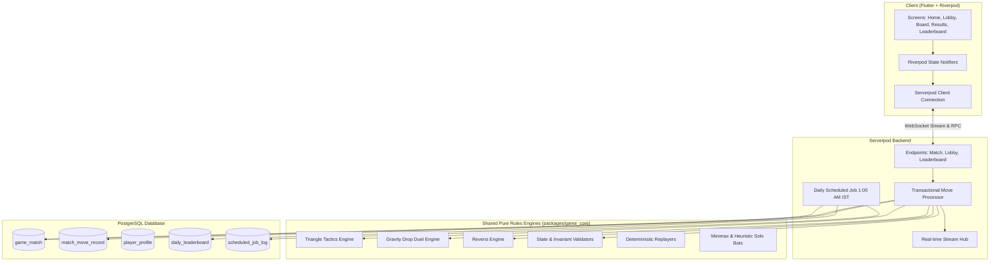
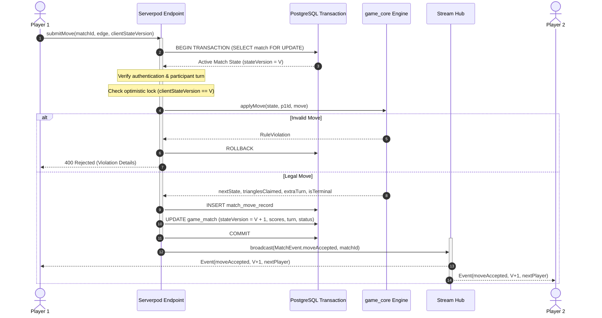

# System Architecture: 1v1 Multiplayer Platform

## 1. System Overview
**1v1** is an extensible, real-time multiplayer gaming platform built on Flutter (client) and Serverpod (authoritative backend with PostgreSQL). The system is architected around deterministic game modules, server-authoritative state transitions, real-time event streaming, and automated background jobs.



---

## 2. Platform Core Contracts & Multi-Game Extensibility

The platform isolates game rules behind a clean abstract interface:

```dart
abstract class GameEngine<TState, TMove, TResult> {
  String get gameId;
  String get rulesetVersion;
  
  TState createInitialState(Map<String, dynamic> config);
  MoveValidationResult validateMove(TState state, String playerId, TMove move);
  TransitionResult<TState> applyMove(TState state, String playerId, TMove move);
  bool isTerminal(TState state);
  TResult evaluateResult(TState state);
  StateValidationResult validateInvariants(TState state);
  Map<String, dynamic> serializeState(TState state);
  TState deserializeState(Map<String, dynamic> json);
}
```

The game catalogue registers engines:
- `triangle_tactics`: Active & Playable (Triangular lattice edge drawing & face capture).
- `connect_four`: Active & Playable (Vertical gravity drop with variable 7×6, 8×7, 9×8 grids and Minimax AI).
- `reversi`: Active & Playable (8×8 flanked disc flipping with positional matrix AI).
- Future planned expansions (`tic_tac_toe`, `memory_duel`): Listed in catalogue with status `comingSoon`.

---

## 3. Authoritative Move Lifecycle & Concurrency Control



### Concurrency & Idempotency:
- `SELECT ... FOR UPDATE` (or optimistic version increment check) serializes concurrent requests on the same match.
- If a client resubmits an identical request due to packet loss, the server recognizes the duplicate either via client move sequence number or version mismatch, returning the already committed state.

---

## 4. Reconnection & Recovery Architecture
- Matches are identified by permanent `matchId` UUIDs.
- Upon client stream reconnection:
  1. Client sends `getMatchState(matchId)`.
  2. Server responds with authoritative snapshot + current `stateVersion`.
  3. Client subscribes to stream filter `matchId`.
  4. If any events were missed between snapshot and stream subscription, the `stateVersion` tag detects the gap and triggers an authoritative sync.

---

## 5. Daily Processing (1:00 AM IST)
- Executed via Serverpod `ScheduledJob` or background task executor configured for `0 1 * * *` in Asia/Kolkata timezone.
- Idempotent: Can be run multiple times per calendar date without double counting.
- Gathers matches completed in the 24-hour window, updates player win/loss/triangles metrics, and generates top 50 daily leaderboard snapshots.
