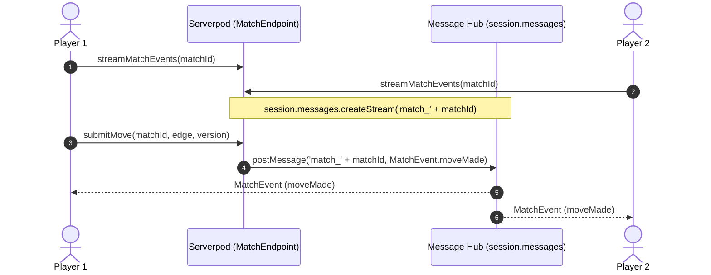

# Serverpod Features Guide: 1v1 Multiplayer Platform

This document details all Serverpod features utilized across the **1v1 Multiplayer Platform**, how they are configured, and where they are implemented in the codebase.

---

## 1. Feature Matrix Overview

| Serverpod Feature | Status | Key Implementation Files | Primary Purpose |
| :--- | :---: | :--- | :--- |
| **Type-Safe API Endpoints** | 🟢 Active | [`match_endpoint.dart`](file:///Users/ananth/work/flutter/1v1/one_v_one_server/lib/src/endpoints/match_endpoint.dart), [`player_endpoint.dart`](file:///Users/ananth/work/flutter/1v1/one_v_one_server/lib/src/endpoints/player_endpoint.dart), [`leaderboard_endpoint.dart`](file:///Users/ananth/work/flutter/1v1/one_v_one_server/lib/src/endpoints/leaderboard_endpoint.dart), [`admin_endpoint.dart`](file:///Users/ananth/work/flutter/1v1/one_v_one_server/lib/src/endpoints/admin_endpoint.dart) | Strongly typed RPC layer generated into `one_v_one_client`. |
| **ORM & Database Entities** | 🟢 Active | [`one_v_one_server/lib/src/models/*.spy.yaml`](file:///Users/ananth/work/flutter/1v1/one_v_one_server/lib/src/models) | PostgreSQL table mapping for matches, moves, player profiles, and daily leaderboards. |
| **Database Migrations** | 🟢 Active | [`one_v_one_server/migrations/`](file:///Users/ananth/work/flutter/1v1/one_v_one_server/migrations) | Declarative schema evolution; auto-migrates on boot and in CI test runner. |
| **Real-Time Streaming** | 🟢 Active | [`match_endpoint.dart:streamMatchEvents`](file:///Users/ananth/work/flutter/1v1/one_v_one_server/lib/src/endpoints/match_endpoint.dart#L128), [`match_service.dart`](file:///Users/ananth/work/flutter/1v1/one_v_one_server/lib/src/services/match_service.dart) | WebSocket event dispatch using Serverpod's built-in message hub (`session.messages`). |
| **Task Scheduling & Future Calls** | 🟢 Active | [`server.dart:145`](file:///Users/ananth/work/flutter/1v1/one_v_one_server/lib/server.dart#L145), [`daily_maintenance_processor.dart`](file:///Users/ananth/work/flutter/1v1/one_v_one_server/lib/src/services/daily_maintenance_processor.dart) | Automated nightly maintenance (1:00 AM IST) for stale lobby cleanup and leaderboard rollups. |
| **Authentication & Auth Callbacks** | 🟢 Active | [`server.dart:21`](file:///Users/ananth/work/flutter/1v1/one_v_one_server/lib/server.dart#L21), [`sign_in_screen.dart`](file:///Users/ananth/work/flutter/1v1/one_v_one_flutter/lib/screens/sign_in_screen.dart) | JWT authentication, password hashing, and post-registration player profile hooks. |
| **In-Memory Caching** | 🟢 Active | [`leaderboard_endpoint.dart`](file:///Users/ananth/work/flutter/1v1/one_v_one_server/lib/src/endpoints/leaderboard_endpoint.dart), [`player_endpoint.dart`](file:///Users/ananth/work/flutter/1v1/one_v_one_server/lib/src/endpoints/player_endpoint.dart) | Local caching (`session.caches.local`) with TTL and cache group invalidation (`leaderboards`, `profiles`). |
| **Cloud Storage & File Uploads** | 🟢 Active | [`server.dart:137`](file:///Users/ananth/work/flutter/1v1/one_v_one_server/lib/server.dart#L137), [`player_endpoint.dart`](file:///Users/ananth/work/flutter/1v1/one_v_one_server/lib/src/endpoints/player_endpoint.dart), [`player_provider.dart`](file:///Users/ananth/work/flutter/1v1/one_v_one_flutter/lib/providers/player_provider.dart) | Direct binary upload description generation and verification for player avatars. |
| **Health Checks & Diagnostics** | 🟢 Active | [`health_route.dart`](file:///Users/ananth/work/flutter/1v1/one_v_one_server/lib/src/web/routes/health_route.dart), [`server.dart:93`](file:///Users/ananth/work/flutter/1v1/one_v_one_server/lib/server.dart#L93) | Public `/healthz` probe validating database connectivity, query latency, server uptime, and cache metrics. |
| **Database Transactions** | 🟢 Active | [`match_service.dart`](file:///Users/ananth/work/flutter/1v1/one_v_one_server/lib/src/services/match_service.dart), [`daily_maintenance_processor.dart`](file:///Users/ananth/work/flutter/1v1/one_v_one_server/lib/src/services/daily_maintenance_processor.dart) | ACID transactions (`session.db.transaction`) guarding move submission and room entry. |
| **Built-in Web Server** | 🟢 Active | [`server.dart:77-131`](file:///Users/ananth/work/flutter/1v1/one_v_one_server/lib/server.dart#L77-L131) | Hosts the Flutter Web SPA, runtime config `/assets/assets/config.json`, static web assets, and health checks. |
| **Logging & Audit Trail** | 🟢 Active | [`admin_endpoint.dart`](file:///Users/ananth/work/flutter/1v1/one_v_one_server/lib/src/endpoints/admin_endpoint.dart), [`match_service.dart`](file:///Users/ananth/work/flutter/1v1/one_v_one_server/lib/src/services/match_service.dart) | Structured diagnostic logging (`session.log`) captured in Serverpod Insights and terminal tails. |

---

## 2. In-Memory Caching (`session.caches.local`)

Serverpod offers high-performance in-memory caching to bypass unnecessary database queries. The application implements caching across two critical read paths:

### 2.1 Leaderboard Caching
- **Implementation**: [`one_v_one_server/lib/src/endpoints/leaderboard_endpoint.dart`](file:///Users/ananth/work/flutter/1v1/one_v_one_server/lib/src/endpoints/leaderboard_endpoint.dart)
- **Daily Leaderboard**:
  ```dart
  final cacheKey = 'daily_leaderboard_${date}_$limit';
  final cachedJson = await session.caches.local.get<String>(cacheKey);
  if (cachedJson != null) {
    return jsonDecode(cachedJson)...;
  }
  // If missed: read from DB, then write to cache with 5-minute TTL
  await session.caches.local.put(
    cacheKey,
    encoded,
    lifetime: const Duration(minutes: 5),
    group: 'leaderboards',
  );
  ```
- **All-Time Leaderboard**: Cached for 2 minutes under the same `'leaderboards'` group.
- **Cache Invalidation**:
  When [`DailyMaintenanceProcessor.run`](file:///Users/ananth/work/flutter/1v1/one_v_one_server/lib/src/services/daily_maintenance_processor.dart) aggregates daily stats at 1:00 AM IST, it immediately invalidates the entire group:
  ```dart
  await session.caches.local.invalidateGroup('leaderboards');
  ```

### 2.2 Player Profile Caching
- **Implementation**: [`one_v_one_server/lib/src/endpoints/player_endpoint.dart`](file:///Users/ananth/work/flutter/1v1/one_v_one_server/lib/src/endpoints/player_endpoint.dart)
- Cached on `getProfile` and `getOrCreateProfile` for 5 minutes under group `'profiles'`.
- Whenever a player updates their profile (display name or avatar) via `updateProfile` or `verifyAvatarUpload`, the specific key is invalidated:
  ```dart
  await session.caches.local.invalidateKey('PlayerProfile-$playerId');
  ```

### 2.3 Administrative Cache Clearing
- [`AdminEndpoint.clearCaches`](file:///Users/ananth/work/flutter/1v1/one_v_one_server/lib/src/endpoints/admin_endpoint.dart) allows clearing `local` and `localPrio` caches on demand during deployments or maintenance.

---

## 3. Public Health Checks & Diagnostics (`/healthz`)

Serverpod includes container orchestration ports on port `8080` (with Kubernetes `/livez` and `/readyz` probes). In addition, a comprehensive public diagnostic route is provided on the web server:

- **Route File**: [`one_v_one_server/lib/src/web/routes/health_route.dart`](file:///Users/ananth/work/flutter/1v1/one_v_one_server/lib/src/web/routes/health_route.dart)
- **Mount Point**: Mounted at `/healthz` on `pod.webServer` in [`server.dart`](file:///Users/ananth/work/flutter/1v1/one_v_one_server/lib/server.dart).
- **Checks Performed**:
  1. **PostgreSQL Connectivity**: Runs an active count query on `ScheduledJobLog.db.count(session)`.
  2. **Query Latency**: Stopwatch measurement in milliseconds (`latencyMs`).
  3. **Server Metrics**: Server ID, runtime mode (`development` / `production`), and uptime in seconds.
  4. **Cache Metrics**: Number of active entries in `localSize` and `localPrio`.

### Sample Response (`GET /healthz`):
```json
{
  "status": "healthy",
  "timestamp": "2026-10-12T11:28:45.120Z",
  "database": {
    "connected": true,
    "latencyMs": 3,
    "totalJobLogs": 42,
    "error": null
  },
  "server": {
    "serverId": "default",
    "runMode": "development",
    "uptimeSeconds": 12430
  },
  "caches": {
    "localCacheEntries": 14,
    "localPrioCacheEntries": 0
  }
}
```

---

## 4. Native Cloud Storage for Avatars (`session.storage` & `FileUploader`)

Rather than bloating database rows with huge base64-encoded strings, Serverpod provides built-in Cloud Storage abstraction (supporting S3, Google Cloud, or PostgreSQL database byte storage).

### 4.1 Storage Provider Setup
Configured in [`server.dart`](file:///Users/ananth/work/flutter/1v1/one_v_one_server/lib/server.dart#L137):
```dart
pod.addCloudStorage(
  await ServerpodCloudProvider.public(
    fallback: () => DatabaseCloudStorage('public'),
  ),
);
```

### 4.2 Direct Upload Endpoints
Implemented in [`PlayerEndpoint`](file:///Users/ananth/work/flutter/1v1/one_v_one_server/lib/src/endpoints/player_endpoint.dart):
1. **`getAvatarUploadDescription`**:
   Creates an authorized upload descriptor for path `avatars/$playerId.png`:
   ```dart
   return await session.storage.createUploadDescription(
     storageId: 'public',
     path: 'avatars/$playerId.png',
   );
   ```
2. **`verifyAvatarUpload`**:
   Verifies the binary payload has landed in storage, resolves its public CDN/download URL via `session.storage.publicDownloadUrl(...)`, updates `PlayerProfile.avatarSeed` with the URL, and flushes the cache.

### 4.3 Flutter Client Upload Flow
In [`one_v_one_flutter/lib/providers/player_provider.dart`](file:///Users/ananth/work/flutter/1v1/one_v_one_flutter/lib/providers/player_provider.dart), `PlayerProfileNotifier.updateAvatar`:
- Detects if an image was picked from a mobile camera/photo library or desktop file picker (represented as a `data:` URI).
- Requests the upload descriptor from `client.player.getAvatarUploadDescription(...)`.
- Streams raw image bytes directly using Serverpod's `FileUploader`:
  ```dart
  final uploader = FileUploader(uploadDesc);
  final uploaded = await uploader.uploadByteData(byteData);
  if (uploaded) {
    final updatedProfile = await client.player.verifyAvatarUpload(...);
  }
  ```
- Gracefully falls back to storing the inline image if the server's cloud storage is in offline/test mode.

---

## 5. Real-Time Streaming & Message Hub (`session.messages`)

Real-time gameplay operates over WebSockets without HTTP polling.



- **Subscription**:
  [`MatchEndpoint.streamMatchEvents`](file:///Users/ananth/work/flutter/1v1/one_v_one_server/lib/src/endpoints/match_endpoint.dart#L128) listens to channel `'match_$matchId'`.
- **Broadcast**:
  In [`MatchService.submitMove`](file:///Users/ananth/work/flutter/1v1/one_v_one_server/lib/src/services/match_service.dart), every authoritative move publishes a `MatchEvent` with the updated state, scores, and active turn.

---

## 6. Task Scheduling & Future Calls

Automated server tasks are handled via Serverpod's cron scheduler without external cron tools:

- **Schedule Registration**:
  Configured in [`server.dart`](file:///Users/ananth/work/flutter/1v1/one_v_one_server/lib/server.dart#L145):
  ```dart
  pod.registerFutureCall(
    DailyMaintenanceCall(),
    'dailyMaintenance',
  );
  pod.scheduleFutureCall(
    'dailyMaintenance',
    null,
    DailyMaintenanceCall.scheduledAt, // 1:00 AM IST (19:30 UTC)
  );
  ```
- **Job Execution**:
  [`DailyMaintenanceProcessor.run`](file:///Users/ananth/work/flutter/1v1/one_v_one_server/lib/src/services/daily_maintenance_processor.dart):
  1. Finds and expires abandoned matchmaking lobbies older than 30 minutes.
  2. Aggregates daily match stats across all completed games for the date.
  3. Writes ranked entries into `DailyLeaderboard`.
  4. Records execution status in `ScheduledJobLog` with execution time and error details.
  5. Invalidates `'leaderboards'` cache group.
  6. Reschedules the future call for the next day.

---

## 7. Authentication & Auth Callbacks

Built using `serverpod_auth_server` and `serverpod_auth_idp`:

- **Configuration**:
  Configured in [`server.dart`](file:///Users/ananth/work/flutter/1v1/one_v_one_server/lib/server.dart#L21) with `JwtConfigFromPasswords()` and `EmailIdpConfigFromPasswords()`.
- **Onboarding Hook**:
  Uses `onAfterAccountCreated` callback to link new user registrations with their player identity:
  ```dart
  onAfterAccountCreated: ({
    required session,
    required email,
    required authUserId,
    required emailAccountId,
    transaction,
  }) async {
    final defaultName = email.split('@').first;
    await PlayerService.getOrCreateProfile(
      session,
      playerId: authUserId.toString(),
      displayName: defaultName,
      transaction: transaction,
    );
  }
  ```

---

## 8. Database Transactions (`session.db.transaction`)

To maintain absolute game state integrity and prevent race conditions:

- Every move submission in [`MatchService.submitMove`](file:///Users/ananth/work/flutter/1v1/one_v_one_server/lib/src/services/match_service.dart#L229) executes inside a PostgreSQL ACID transaction:
  ```dart
  await session.db.transaction((tx) async {
    final match = await GameMatch.db.findById(session, matchId, transaction: tx);
    // Optimistic locking check:
    if (clientStateVersion != match.stateVersion) {
      throw StateError('State version mismatch');
    }
    // Apply deterministic rule update via game_core...
    await GameMatch.db.updateRow(session, updatedMatch, transaction: tx);
    await MatchMoveRecord.db.insertRow(session, moveRecord, transaction: tx);
  });
  ```
- Joining private/public rooms in `MatchService.joinMatch` uses transactions to prevent multiple players claiming the opponent slot simultaneously.

---

## 9. Built-in Web Server & Flutter SPA Hosting

Serverpod's `pod.webServer` eliminates the need for Nginx or external web proxies in single-container deployments:

- Serves static assets from `web/static/` under cache-busted routes.
- Serves Flutter Web build from `web/app` with SPA fallback routing.
- Serves dynamic API configuration at `/assets/assets/config.json`.
- Serves health check diagnostics at `/healthz`.

---

## 10. Developer Workflows & Verification

### Running the Environment
```bash
# Starts Serverpod server, PostgreSQL, and Flutter web watcher
serverpod start
```

### Verification Commands
```bash
# Analyze code
dart analyze

# Run unit & integration test suites (tests use embedded Postgres, no Docker needed)
cd one_v_one_server && dart test
cd ../one_v_one_flutter && flutter test

# Code formatting
dart format .
```
